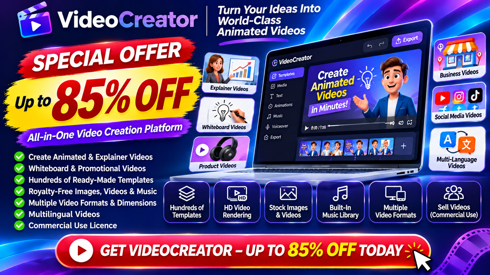

# 🎬 VideoCreator Promo Code – Get Up to 85% OFF Animated Video Creator

---

  

  **Want to create professional animated videos without complicated editing software or expensive production costs?**
   
  Turn your ideas into engaging videos for marketing, social media, businesses, education, products, and more — in different shapes, topics, and languages.

  🎉 **<a href="https://deal.ink/VideoCreator">CLAIM YOUR VIDEOcreator DISCOUNT – UP TO 85% OFF</a>**

---

## 📑 Table of Contents

1. [What Is VideoCreator?](#what-is-videocreator)
2. [How Does VideoCreator Work?](#how-does-videocreator-work)
3. [VideoCreator Features](#videocreator-features)
4. [Types of Videos You Can Create](#types-of-videos-you-can-create)
5. [Who Should Use VideoCreator?](#who-should-use-videocreator)
6. [How to Make Money With VideoCreator](#how-to-make-money-with-videocreator)
7. [VideoCreator Pricing and Plans](#videocreator-pricing-and-plans)
8. [How to Create Your First Video](#how-to-create-your-first-video)
9. [Benefits of Using VideoCreator](#benefits-of-using-videocreator)
10. [Things to Consider Before Buying](#things-to-consider-before-buying)
11. [Frequently Asked Questions](#frequently-asked-questions)
12. [Get Up to 85% OFF VideoCreator](#get-up-to-85-off-videocreator)
13. [Final Verdict](#final-verdict)
14. [Affiliate Disclosure](#affiliate-disclosure)

---

## What Is VideoCreator?

Video has become one of the most effective ways to communicate online.

Businesses use videos to promote products, content creators use them to engage audiences, educators use them to explain complicated topics, and marketers use them to attract customers.

But creating professional-looking videos can be challenging.

Traditional video production may require editing software, animation skills, stock footage, music, voiceovers, and hours of work.

For beginners, freelancers, and small businesses, these requirements can make video creation expensive and time-consuming.

**VideoCreator is designed to make video production easier.**

It is an all-in-one, cloud-based video creation platform that helps users turn ideas into animated and promotional videos using ready-made templates, visual assets, text effects, animations, and customization tools.

The platform is designed for creating videos for different goals, topics, languages, and dimensions.

You can use it to produce content such as:

- Animated marketing videos
- Explainer videos
- Whiteboard videos
- Product demonstration videos
- E-commerce promotional videos
- Social media videos
- YouTube videos
- Business advertisements
- Logo reveal videos
- Video mockups
- Animated presentations
- Educational videos
- Corporate promotional videos

VideoCreator also advertises a library of templates, royalty-free images and videos, background music, and commercial-use options.

The idea is simple: choose a suitable video template, customize it with your own content, and render the finished video.

**Want to explore the current promotional offer?**

👉 [Get VideoCreator – Claim Up to 85% OFF](https://deal.ink/VideoCreator)

---

## How Does VideoCreator Work?

VideoCreator is designed to simplify the video creation process.

Instead of starting with a completely blank editing timeline, you can work with ready-made templates and customize them for your project.

### Step 1: Access Your VideoCreator Account

After purchasing your preferred package, sign in to your VideoCreator account.

The platform is cloud-based, so you don't need to install traditional desktop video editing software to access the advertised video creation tools.

### Step 2: Choose a Video Template

Browse the available templates and select one that matches your project.

For example:

- A product advertisement
- A business promotional video
- An animated explainer
- A social media promotion
- A whiteboard presentation
- A YouTube marketing video

Starting with a template can save time compared with designing every scene yourself.

### Step 3: Customize Your Video

Add your own content and personalize the template.

Depending on the selected template, you can customize elements such as:

- Text and headlines
- Images and graphics
- Video clips
- Logos and branding
- Background music
- Fonts and text effects
- Colours and visual elements

You can also upload your own media assets.

### Step 4: Add Music and Visual Assets

Use the available image, video, and music libraries to improve your project.

You can also upload your own images, videos, and music files.

Make sure you have the necessary rights to use any assets you upload or include in your finished videos.

### Step 5: Select Your Video Format

VideoCreator advertises video dimensions suitable for different platforms and purposes.

Depending on the selected template and available settings, you can create:

- Landscape videos
- Square videos
- Vertical videos
- Rectangle videos

This is useful because a YouTube video, Instagram Reel, and Facebook advertisement may require different dimensions.

### Step 6: Preview and Render Your Video

Review your project before generating the final video.

Check the spelling, timing, images, transitions, music, and overall presentation.

Once everything looks right, render your video and use it for your intended purpose.

---

## VideoCreator Features

VideoCreator combines several video creation capabilities in one platform.

Here are its main advertised features and how they may be useful.

### 1. Hundreds of Ready-Made Video Templates

One of the platform's main features is its collection of ready-to-use video templates.

Templates provide a starting point for different video styles and marketing purposes.

Instead of designing every scene from scratch, you can select a suitable template and customize it.

This can be especially useful for people who need to create videos regularly.

### 2. Multiple Video Formats and Dimensions

Different platforms require different video dimensions.

A landscape video may work well for YouTube, while vertical videos are commonly used for short-form social content.

VideoCreator advertises support for different video shapes and dimensions, including:

- Landscape
- Vertical
- Square
- Rectangle

This makes it easier to prepare videos for different marketing channels.

### 3. Animated Video Creation

VideoCreator is designed to help users create animated videos without requiring advanced animation skills.

You can use its available templates and animation effects to produce engaging visual content.

This can be useful for marketing campaigns, presentations, product promotions, and educational content.

### 4. Explainer Videos

Explainer videos help communicate ideas, products, and services in a simple visual format.

You can use them to:

- Introduce a new product
- Explain how a service works
- Describe a business process
- Present a solution to a problem
- Educate potential customers

A well-structured explainer video can make complicated information easier to understand.

### 5. Whiteboard Videos

Whiteboard-style videos are commonly used for education, training, and explanations.

They present information using illustrated elements, text, and animated drawing effects.

This format can be useful for:

- Educational content
- Online courses
- Tutorials
- Business presentations
- Product explanations

### 6. Product and E-commerce Videos

Product videos can help businesses present their products in a more engaging way.

VideoCreator advertises product showcase and e-commerce video formats.

You can use these types of videos to highlight:

- Product features
- Benefits
- Different product angles
- Promotional offers
- Product demonstrations
- Calls to action

These videos may be useful for online stores, product marketers, and affiliate marketers.

### 7. Local Business Promotional Videos

Businesses often need promotional content to attract customers.

VideoCreator advertises templates featuring real human actors in different professional and business-related scenarios.

These can be used to create promotional videos for industries such as:

- Healthcare
- Real estate
- Construction
- Fitness
- Retail
- Professional services
- Local businesses

This can help create a more recognizable business message without arranging a traditional video shoot for every project.

### 8. 360-Degree Animation Videos

VideoCreator advertises 360-degree animation options designed to create visually distinctive content.

This type of animation can be useful for promotional campaigns, product presentations, and attention-grabbing marketing content.

Availability may depend on the template and package.

### 9. Video Flipbooks

The platform also advertises animated video flipbooks.

These can turn images and other visual content into a more dynamic presentation.

Potential uses include:

- Digital brochures
- Product catalogs
- E-books
- Educational material
- Business presentations
- Promotional content

### 10. Royalty-Free Image and Video Library

Finding suitable images and footage can take time.

VideoCreator advertises access to a large collection of royalty-free images and videos, including integrations with image libraries such as Pixabay and Pexels.

This can help users find visual assets for their projects without searching for every image separately.

Always review the applicable asset licence and usage conditions, particularly for commercial projects.

### 11. Built-In Music Library

Music can make a major difference to the overall presentation of a video.

VideoCreator includes a built-in music library with tracks intended for video projects.

You can select suitable background music to match the mood and purpose of your content.

Check the licence conditions for the music you use, especially when creating videos for clients or paid advertisements.

### 12. Text Effects and Animations

Text is an important part of many promotional and explainer videos.

VideoCreator advertises text effects and animation features that can help make headlines, messages, and calls to action more visually engaging.

### 13. Upload Your Own Media

You are not limited to the assets provided by the platform.

VideoCreator allows you to upload your own:

- Images
- Videos
- Logos
- Music
- Other media assets

This helps you maintain your own branding and use content created specifically for your business or clients.

### 14. Background Removal

The advertised commercial package includes unlimited background removal.

This can help prepare images for video projects by removing unwanted backgrounds from supported image assets.

It may be useful when creating product promotions, presentations, and branded visual content.

### 15. Video Resizer

VideoCreator advertises a video resizing feature.

This can help adapt content for different video dimensions and social media formats.

You should still review the resized output to make sure important text, logos, and visual elements remain properly positioned.

### 16. Large Font Library

The commercial package advertises access to a large font library.

Different fonts can help you create a consistent visual identity and match the style of your video.

For business and client projects, make sure the fonts you use are licensed for your intended purpose.

### 17. Full HD Video Rendering Options

The commercial package advertises 720p HD video rendering.

The optional VideoCreator Deluxe and bundle offers advertise 1080p Full HD rendering.

Check the exact package before purchasing if 1080p output is important to your work.

### 18. Unlimited Video Renders

VideoCreator advertises unlimited video renders with its commercial licence.

This can be useful if you create videos frequently or need to produce multiple versions of a marketing campaign.

Review the applicable licence and fair-use terms before relying on unlimited rendering for large-scale production.

### 19. Multilingual Video Support

VideoCreator advertises support for creating videos in different languages.

You can use text in different languages and upload your own voiceovers.

This can be useful for businesses and creators who want to reach audiences in different countries.

For example, you could create separate versions of a promotional video in English, French, Urdu, Spanish, or other languages.

The quality of the final result will depend on the text, voiceover, pronunciation, and media assets you provide.

### 20. Cloud-Based Platform

VideoCreator is advertised as a cloud-based application.

You don't need to download and install traditional video editing software to access the platform.

This can make it easier to work from supported computers with an internet connection.

### 21. Commercial Licence

The commercial package advertises commercial rights, allowing users to create videos for clients and sell video creation services.

This may be useful for freelancers, agencies, and entrepreneurs who want to build a video production business.

Always review the actual licence terms to understand the permitted uses, restrictions, and third-party asset conditions.

### 22. Step-by-Step Training and Support

VideoCreator advertises training resources to help users learn the platform.

The commercial offer also mentions access to support and training-related communities and webinars.

These resources may be useful for beginners who are new to video creation.

---

## Types of Videos You Can Create

VideoCreator is designed for different marketing goals, industries, and content formats.

Here are some examples of what you can create.

| Video Type | Possible Purpose |
|---|---|
| Explainer Videos | Explain products, services, or complicated topics |
| Animated Videos | Create engaging visual content |
| Whiteboard Videos | Present educational and instructional information |
| Product Videos | Showcase product features and benefits |
| E-commerce Videos | Promote products for online stores |
| YouTube Videos | Create content for video channels |
| Social Media Videos | Prepare promotional content for social platforms |
| Logo Reveals | Introduce a brand with animated visuals |
| Video Mockups | Present products and creative designs |
| Corporate Videos | Share company information and announcements |
| Local Business Ads | Promote local services and businesses |
| Educational Videos | Explain lessons, concepts, and processes |
| 360-Degree Animations | Create distinctive promotional visuals |
| Video Flipbooks | Present brochures, catalogs, and visual documents |

### Create Videos for Different Platforms

You can adapt your video projects for different channels.

**YouTube**

Create explainer videos, product demonstrations, presentations, and promotional content.

**Instagram**

Prepare square and vertical videos for posts, stories, and short-form content.

**Facebook**

Create promotional videos for business pages, product campaigns, and advertisements.

**TikTok**

Prepare vertical promotional and educational videos.

**Websites and Landing Pages**

Use product videos, explainer videos, and promotional clips to communicate your message.

**Email Marketing**

Include suitable video previews or links in email campaigns to make your promotions more engaging.

---

## Who Should Use VideoCreator?

VideoCreator may be useful for people who need to produce video content regularly but don't want to manage a complicated production process.

### 1. Digital Marketers

Digital marketers need different types of content for campaigns, landing pages, advertisements, and social media.

VideoCreator can help create promotional videos and visual content for different marketing goals.

### 2. Affiliate Marketers

Affiliate marketers often need product demonstrations, review videos, promotional clips, and social media content.

You can use VideoCreator to create videos that introduce products, explain features, and direct viewers to relevant affiliate offers.

### 3. Small Business Owners

Small businesses can use videos to introduce their services, showcase products, and communicate promotional offers.

This can be useful for local businesses that want more engaging marketing material.

### 4. Freelancers and Video Creators

Freelancers can use ready-made templates to create videos for clients.

The advertised commercial licence may also allow eligible users to sell video creation services.

### 5. Social Media Managers

Managing several social media accounts often requires producing content in different formats.

VideoCreator's multiple dimensions and templates may help simplify the process.

### 6. YouTubers and Content Creators

Content creators can use the platform to produce promotional clips, animated explanations, intros, and other supporting videos.

### 7. E-commerce Store Owners

Online store owners can create product showcase videos and promotional content for their products.

### 8. Educators and Trainers

Teachers, trainers, and course creators can use animated and whiteboard-style videos to explain concepts and present educational information.

### 9. Marketing Agencies

Agencies may use the commercial licence and available templates to produce videos for different clients.

### 10. Beginners With No Video Editing Experience

If you are new to video creation, ready-made templates can provide a starting point.

You can focus on selecting suitable content and customizing the design rather than learning every feature of a traditional video editor.

---

## How to Make Money With VideoCreator

One of the interesting possibilities of a video creation platform is using it to offer services to other businesses.

You don't have to create videos only for your own projects.

With the appropriate commercial licence, you can explore different business models.

### 1. Offer Video Creation Services

Create promotional videos for small businesses and charge for your work.

Potential clients include:

- Restaurants
- Real estate agents
- Cleaning companies
- Fitness studios
- Retail stores
- Consultants
- Contractors
- Local service providers

You could offer different packages depending on video length, complexity, and the amount of customization required.

### 2. Create Social Media Videos for Businesses

Businesses need regular content for their social media accounts.

You could offer monthly video creation packages that include:

- Promotional videos
- Product highlights
- Service introductions
- Special offers
- Educational clips
- Seasonal campaigns

This may help you develop ongoing relationships with clients.

### 3. Create Product Demonstration Videos

Online sellers often need videos that explain how their products work.

You could create product showcase videos for e-commerce businesses and online stores.

### 4. Offer Whiteboard and Explainer Video Services

Whiteboard and explainer videos are useful for businesses that need to communicate complicated information.

Potential customers include software companies, educators, consultants, and professional service providers.

### 5. Create Videos for Affiliate Marketing

If you promote products through affiliate programs, you can create videos that explain product features, benefits, and use cases.

You can publish these videos on YouTube and social media platforms and direct interested viewers to your affiliate links.

Always disclose affiliate relationships clearly.

### 6. Create Videos for YouTube Channels

You could help YouTubers create supporting content such as:

- Animated introductions
- Explainer clips
- Promotional videos
- Product demonstrations
- Channel advertisements

### 7. Create Promotional Videos for Real Estate Agents

Real estate professionals need content to promote properties, services, and local markets.

You could offer video creation services for property promotions and business advertisements.

### 8. Create Educational Videos

Teachers, tutors, and online course creators may need animated explanations and instructional content.

You could create videos for educational projects and training materials.

### 9. Build a Small Video Marketing Agency

If you develop your video creation skills and build a client base, you could expand into a small video marketing service.

Potential services include:

- Video creation
- Social media content
- Product promotions
- Explainer videos
- Business advertisements
- Video resizing and formatting

### 10. Sell Video Creation Packages

Instead of charging separately for every video, you could create service packages.

For example:

- Starter package: A small number of short promotional videos.
- Business package: Multiple videos for social media and marketing.
- Premium package: Customized videos, branding, and ongoing content creation.

Set your prices according to the time, effort, customization, and value delivered.

**Important:** These are potential business opportunities, not guaranteed income sources. Your results depend on video quality, marketing, customer service, pricing, and your ability to find clients.

---

## VideoCreator Pricing and Plans

VideoCreator advertises one-time payment options rather than mandatory monthly subscriptions for its advertised commercial and bundle offers.

The published promotional pages show different prices and discounts depending on the offer.

### Commercial Package

One published offer advertises the Commercial package at $49 USD as a one-time payment, reduced from $69 USD.

The advertised package includes:

- Hundreds of video templates
- All-in-one VideoCreator application
- Different video dimensions
- Royalty-free images and videos
- Built-in music library
- 720p HD video rendering
- Step-by-step training
- Unlimited video renders
- Upload your own media
- Multilingual video support
- Commercial licence
- Unlimited background removal
- Video resizer
- Large font library
- Ability to sell created videos
- Training and community access

### Bundle Deal

A separate published offer advertises a bundle at $97 USD as a one-time payment, reduced from $241 USD.

The advertised bundle includes the Commercial package and additional applications or upgrades.

These may include:

- VideoCreator Deluxe
- VidEditor Unlimited
- VoiceSuite Unlimited
- VideoPlayer Unlimited
- 1080p HD video rendering
- 200+ premium video templates
- Text-to-speech functionality
- Additional editing and video tools
- Unlimited video renders
- One-time payment structure

The exact bundle contents can vary by promotional offer.

### Commercial vs Bundle

| Feature | Commercial | Bundle |
|---|---|---|
| Payment Type | One-time | One-time |
| VideoCreator | Included | Included |
| Video Templates | Hundreds | 200+ premium templates advertised |
| Video Dimensions | Multiple formats | Multiple formats |
| Video Rendering | 720p HD advertised | 1080p HD advertised |
| Unlimited Renders | Advertised | Advertised |
| Commercial Licence | Included | Included through Commercial |
| Background Removal | Included | Included through Commercial |
| Additional Applications | Not all included | Additional applications included |
| Text-to-Speech | Optional upgrade may apply | Included in advertised bundle |
| Video Editing Tools | Core application | Additional editing tools |

### Important Pricing Information

The published offers display different prices, discounts, and package combinations.

The prices above are examples from published promotional offers, not guaranteed prices for every visitor.

The advertised 85% OFF promotion may use a different checkout offer or package.

Before purchasing, compare the available packages and confirm:

- The final price
- The selected licence
- Video resolution
- Included applications
- Template availability
- Commercial usage rights
- Any optional upgrades
- Refund terms

---

## How to Create Your First Video

If you are new to video creation, here is a simple process to follow.

### Step 1: Decide What You Want to Create

Start with one clear objective.

For example:

- Promote a product
- Advertise a local business
- Explain a service
- Create a YouTube video
- Produce an educational presentation
- Create a social media advertisement

Having a clear goal will help you choose the right template.

### Step 2: Prepare Your Content

Before opening the editor, prepare the basic information for your video.

This may include:

- Video title
- Main message
- Short script
- Logo
- Product images
- Business information
- Website address
- Call to action

You don't need to write a complicated script for every project.

A simple structure can work well:

1. Introduce the problem.
2. Present the product or service.
3. Explain the main benefits.
4. Show why it matters.
5. Finish with a clear call to action.

### Step 3: Choose a Template

Browse the available templates and select one that matches your video goal.

For example, choose a product-focused template for an advertisement or an explainer template for educational content.

### Step 4: Customize Your Video

Replace the sample content with your own text, images, logo, and other media.

Make sure the message is clear and easy to understand.

### Step 5: Add Music and Effects

Choose background music and visual effects that match the purpose of your video.

Avoid adding too many effects that distract viewers from the main message.

### Step 6: Review the Video

Watch the complete video before rendering.

Check:

- Spelling and grammar
- Text placement
- Image quality
- Music volume
- Scene timing
- Logo visibility
- Call-to-action wording

### Step 7: Render and Publish

Once you are happy with the result, render the video using the available output settings.

You can then publish it on your website, YouTube channel, social media account, or use it in your marketing campaign.

---

## Benefits of Using VideoCreator

Creating videos can require several tools and resources.

VideoCreator aims to bring multiple video creation capabilities together in one platform.

Here are some potential benefits.

### Save Time With Ready-Made Templates

Starting with a template can reduce the time spent designing every scene manually.

### Reduce the Need for Complex Editing Software

The platform is designed to make video creation more accessible to people without advanced editing skills.

### Create Different Video Formats

You can work with different video dimensions for different marketing channels.

### Use Built-In Visual Assets

The advertised image, video, and music libraries can make it easier to find suitable assets for your projects.

### Create Multilingual Content

You can use text and uploaded voiceovers in different languages to prepare content for different audiences.

### Produce Videos for Clients

The advertised commercial licence may allow you to create and sell videos as a service.

### Avoid Mandatory Monthly Fees on Advertised Offers

The published Commercial and Bundle offers advertise one-time payments.

This may appeal to users who prefer not to commit to another recurring software subscription.

### Create Multiple Videos

The platform advertises unlimited video renders under its commercial offer.

This can be useful for people who need to produce content regularly.

---

## Things to Consider Before Buying

VideoCreator offers several video creation features, but you should understand the package details and limitations before purchasing.

### 1. Review the Included Video Resolution

The Commercial package advertises 720p HD rendering, while 1080p is advertised with the Deluxe and Bundle options.

If Full HD output is important, confirm that the package you select includes it.

### 2. Check the Template Library

The platform advertises hundreds of templates, with additional premium templates included in certain offers.

Review the available template styles to make sure they fit the type of videos you want to create.

### 3. Understand Optional Upgrades

VideoCreator offers additional applications and upgrades.

Some packages include these tools, while others may require a separate purchase.

Don't assume every feature shown in promotional material is included in the basic Commercial package.

### 4. Review the Commercial Licence

If you intend to sell videos to clients, review the commercial licence carefully.

Understand what you can sell, what restrictions apply, and whether any third-party assets have separate usage conditions.

### 5. Check Asset Licensing

A royalty-free asset is not necessarily free of all restrictions.

Review the applicable terms for images, video clips, music, fonts, and other assets.

### 6. Expect to Customize the Templates

Templates provide a starting point, but the final result still depends on your content and editing.

Avoid publishing videos that look generic or contain irrelevant sample text and images.

### 7. Confirm the Current Offer

Promotional prices and discounts can change.

Check the final checkout price and package details before completing your purchase.

---

## Frequently Asked Questions

### 1. What is VideoCreator?

VideoCreator is a cloud-based video creation platform that helps users create animated, promotional, explainer, whiteboard, product, and other types of videos using templates and customization tools.

### 2. Do I need video editing experience?

No advanced video editing experience is required to get started with its template-based workflow.

Beginners can select templates and customize them with their own text, images, and other media.

### 3. What types of videos can I create?

You can create different types of videos, including explainer videos, animated videos, whiteboard videos, product demonstrations, e-commerce videos, social media content, YouTube videos, and business advertisements.

### 4. Does VideoCreator support different video dimensions?

Yes. VideoCreator advertises landscape, square, vertical, and rectangle video formats.

### 5. Can I create videos in different languages?

Yes. The platform advertises multilingual support. You can use text in different languages and upload your own voiceovers.

### 6. Can I upload my own images and videos?

Yes. VideoCreator allows users to upload their own images, videos, logos, and music.

Make sure you have permission to use the assets in your projects.

### 7. Does VideoCreator include background music?

Yes. The platform advertises a built-in music library.

Check the relevant licence conditions before using music in commercial projects.

### 8. Does VideoCreator include stock images and videos?

The platform advertises access to royalty-free image and video assets, including integrations with libraries such as Pixabay and Pexels.

### 9. Can I create videos for clients?

The Commercial package advertises a commercial licence that allows users to create and sell videos to clients.

Review the licence terms for the exact permissions and restrictions.

### 10. Can I sell the videos I create?

Yes, the advertised commercial licence allows users to sell eligible video creation services and videos to clients.

Third-party asset licences and other usage conditions may still apply.

### 11. Does VideoCreator add watermarks?

The published promotional material advertises customizable videos without watermarks.

Check the selected package and current terms before purchasing.

### 12. Does VideoCreator support HD video rendering?

The Commercial package advertises 720p HD rendering. The Deluxe and Bundle offers advertise 1080p HD rendering.

### 13. Is VideoCreator cloud-based?

Yes. VideoCreator is advertised as a cloud-based platform that does not require traditional software installation.

### 14. Does VideoCreator offer unlimited video renders?

Yes. Unlimited video rendering is advertised with the commercial offer.

Review the applicable terms and licence before relying on this for high-volume production.

### 15. Does VideoCreator charge monthly fees?

The published Commercial and Bundle offers advertise one-time payments without mandatory monthly subscription fees.

Check the checkout terms for optional upgrades and any additional services.

### 16. Is VideoCreator suitable for beginners?

Yes. Ready-made templates and step-by-step training are designed to make the platform accessible to beginners.

### 17. Can I use VideoCreator for affiliate marketing?

Yes. You can create product promotions, review videos, explainer videos, and social media content for affiliate marketing.

Remember to disclose affiliate relationships and follow the rules of the platforms where you publish.

### 18. Does VideoCreator offer a money-back guarantee?

The published promotional pages advertise a 30-day money-back guarantee. Review the current refund policy and eligibility requirements before purchasing.

### 19. Are additional upgrades available?

Yes. The published offers mention optional upgrades such as VideoCreator Deluxe, VidEditor Unlimited, VoiceSuite Unlimited, and VideoPlayer Unlimited.

Some upgrades are included in the advertised Bundle package.

### 20. How can I get the VideoCreator discount?

Use the promotional link below to explore the current offer and check the available discount.

[Claim Up to 85% OFF VideoCreator](https://deal.ink/VideoCreator)

---

## Get Up to 85% OFF VideoCreator

If you want to create animated videos, promotional content, explainer videos, product demonstrations, or social media advertisements, VideoCreator may be worth exploring.

Its combination of ready-made templates, visual assets, music, text effects, multiple video dimensions, multilingual support, and commercial-use options provides different ways to approach video creation.

It may be particularly interesting for:

- Digital marketers
- Affiliate marketers
- Freelancers
- Small business owners
- Social media managers
- Content creators
- Marketing agencies
- Entrepreneurs

You can also explore the advertised commercial licence if you want to offer video creation services to clients.

### Claim Your VideoCreator Discount

🎬 **[GET VIDEOcreator – CLAIM UP TO 85% OFF](https://deal.ink/VideoCreator)**

Explore the available packages, compare the included features, and confirm the final checkout price before purchasing.

---

## Final Verdict

VideoCreator is designed to make animated and promotional video production more accessible.

Instead of relying entirely on complicated editing software or creating every scene from scratch, you can start with ready-made templates and customize them for your project.

Its advertised features cover a wide range of video creation needs, including explainer videos, whiteboard videos, product promotions, social media content, business advertisements, and multilingual videos.

For beginners, it provides a template-based approach to video creation.

For freelancers and agencies, the commercial licence may offer an opportunity to provide video creation services to clients.

For marketers and content creators, the different formats and templates can help produce content for multiple platforms.

However, the final video still needs your creative input, customization, and quality checks. It is also important to review the included resolution, optional upgrades, and commercial licence before choosing a package.

If you want to explore a video creation platform that combines templates, visual assets, animation, and commercial-use options, VideoCreator is worth checking out.

🚀 **[EXPLORE VIDEOcreator – CLAIM UP TO 85% OFF TODAY](https://deal.ink/VideoCreator)**

---

## Affiliate Disclosure

This article contains an affiliate link to VideoCreator.

If you purchase through the link provided in this article, I may earn a commission or referral benefit at no additional cost to you.

The purpose of this guide is to help readers understand VideoCreator's features, potential uses, pricing options, and limitations before making a purchasing decision.

Product features, templates, pricing, package contents, commercial licensing terms, and promotional discounts may change. Always review the latest offer and terms before completing your purchase.
